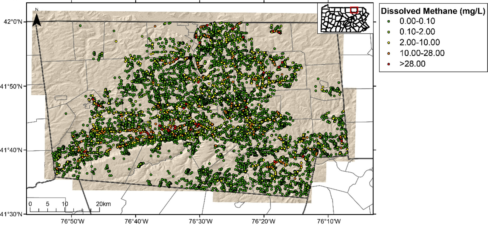

---
aliases:
  - swpa-groundwater-2022.html
title: "Bradford County Groundwater: May 2018 Compilation"
description: "A Shale Network groundwater subset used to study water-quality patterns in Bradford County, Pennsylvania."
date: "2018-05-22"
categories: [Groundwater, Bradford County]
image: bradford-co-groundwater-2018.jpg
page-layout: full
toc: false
sidebar: false
---

This compilation brings together groundwater observations from Bradford County, Pennsylvania, held in Shale Network as of May 2018. It accompanies [Wen and colleagues' 2018 study](https://doi.org/10.1021/acs.est.8b01123) of groundwater chemistry in a region of Marcellus Shale development.

[Download the dataset from Penn State Data Commons](https://doi.org/10.26208/RJ0H-QF52).

May 2018 identifies the compilation, not the sampling period. The dataset is a defined subset of Shale Network records and does not represent every groundwater analysis in the county. Read the repository metadata and article for dates, methods, and the basis for interpreting water-quality patterns.

{fig-alt="Groundwater sampling locations in Bradford County, Pennsylvania, colored by dissolved methane concentration."}

For methods and interpretation, see the associated [Wen et al. (2018) study](https://doi.org/10.1021/acs.est.8b01123).

[Data-use guidance](../data-use-and-embargo-policy.qmd)
