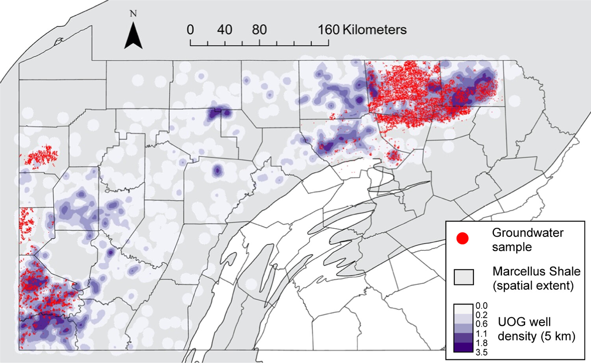

This groundwater compilation is the Shale Network subset associated with [Shaheen and colleagues' 2024 study of regional salinization](https://doi.org/10.1021/acs.est.4c03371). It is available through [Penn State Data Commons](https://doi.org/10.26208/DT5Y-5B37).

The study examines groundwater chemistry in relation to oil and gas wells, wastewater impoundments, and documented regulatory violations. Its samples were predominantly collected between April 2008 and April 2020. **September 2024 identifies the compilation, not the sampling period.**

This is a defined research dataset, not an inventory of every groundwater analysis in Pennsylvania. Consult the repository files and article for sampling coverage, analytes, methods, and interpretation.

{fig-alt="Groundwater sampling locations across Pennsylvania's Marcellus Shale region, shown with unconventional oil and gas well density."}

For methods and interpretation, see the associated [Shaheen et al. (2024) study](https://doi.org/10.1021/acs.est.4c03371).

[Data-use guidance](../data-use-and-embargo-policy.qmd)
