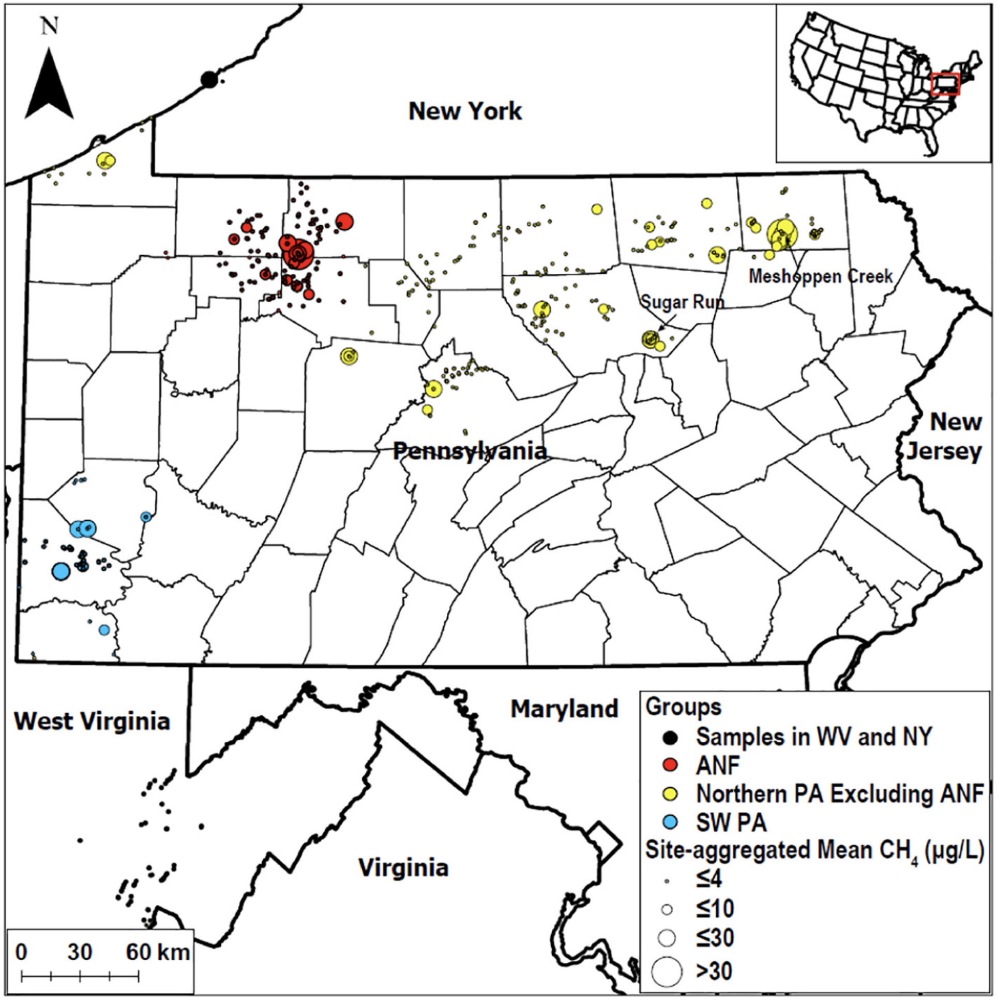

[Woda and colleagues' 2020 study](https://doi.org/10.1016/j.scitotenv.2020.140105) reports methane measurements from stream sites in Pennsylvania, New York, and West Virginia. It examines methane in areas with histories of oil, gas, and coal development.

The article's supplementary data provide the study dataset. This is a selected research collection, not a complete census of northeastern U.S. streams. The 2020 date refers to the study's publication; sampling dates and site selection are described in the article and supporting files.

{fig-alt="Stream sampling sites in Pennsylvania and nearby areas of New York and West Virginia, with symbol size indicating mean methane concentration at each site."}

See [Woda et al. (2020)](https://doi.org/10.1016/j.scitotenv.2020.140105) for the sampling design and interpretation of the regional groups.

[Data-use guidance](../data-use-and-embargo-policy.qmd)
