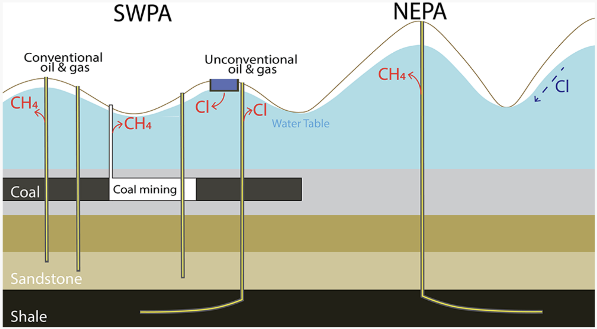

---
aliases:
  - bradford-co-groundwater-2018.html
title: "Southwestern Pennsylvania Groundwater: 2022 Study Dataset"
description: "Groundwater observations from Beaver, Washington, and Greene counties used in a study of overlapping hydrocarbon development."
date: "2022-06-29"
categories: [Groundwater, Southwestern Pennsylvania]
image: swpa-groundwater-2022.png
page-layout: full
toc: false
sidebar: false
---

This Shale Network subset contains groundwater observations from Beaver, Washington, and Greene counties in southwestern Pennsylvania. It accompanies [Shaheen and colleagues' 2022 study](https://doi.org/10.1021/acs.est.2c00001) of groundwater chemistry where shale gas development overlaps with earlier oil, gas, and coal extraction.

[Download the dataset from Penn State Data Commons](https://doi.org/10.26208/2NQE-WD53).

The 2022 date identifies this study compilation. It does not imply that all samples were collected in 2022 or that the dataset covers every groundwater source in southwestern Pennsylvania. Consult the repository metadata and article for sampling dates, analytical methods, and the limits of the study.

{fig-alt="Conceptual cross section contrasting southwestern and northeastern Pennsylvania, with possible methane and chloride pathways near oil and gas wells, coal mining, and wastewater storage."}

For methods and interpretation, see the associated [Shaheen et al. (2022) study](https://doi.org/10.1021/acs.est.2c00001).

[Data-use guidance](../data-use-and-embargo-policy.qmd)
