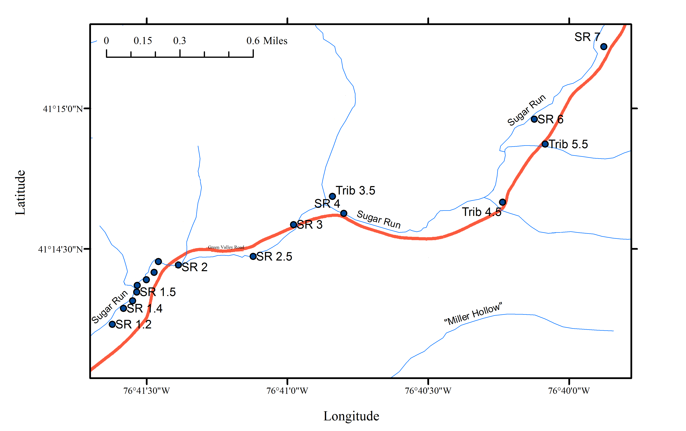

[Woda and colleagues (2018)](https://doi.org/10.1073/pnas.1809013115) investigated methane and associated geochemical changes near Sugar Run in Lycoming County, Pennsylvania. The study combines local observations with regional groundwater data to examine methane sources and migration.

## Download the groundwater compilation

[Lycoming County Groundwater as of October 2018](https://doi.org/10.18113/D35M2X) is a groundwater subset of Shale Network published through Penn State Data Commons. It provides regional context for the study. The linked repository record describes groundwater; it should not be read as a download of all the study's stream measurements.

For the broader investigation, including Sugar Run observations and supporting methods, use the [article and supplementary files](https://pmc.ncbi.nlm.nih.gov/articles/PMC6298102/). October 2018 identifies the groundwater compilation, not the dates of every sample.

{fig-alt="Map of sampling locations along Sugar Run and its tributaries in Lycoming County, Pennsylvania."}

Sugar Run study-area map. See [Woda et al. (2018)](https://doi.org/10.1073/pnas.1809013115) for the investigation's methods and interpretation.

[Data-use guidance](../data-use-and-embargo-policy.qmd)
