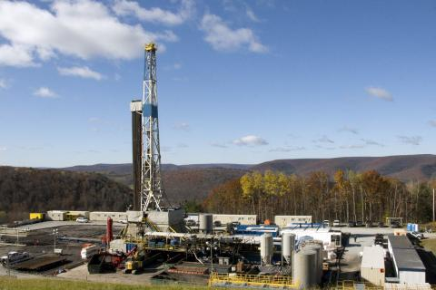

*News archive. From [Penn State News](https://www.psu.edu/news/research/story/bradford-co-water-quality-improves-impacts-rare-near-shale-gas-wells); reporting and affiliations reflect the historical story.*

{fig-alt="Drilling rig and equipment on a well pad among wooded hills"}

Photo: Henry Wong, via Penn State News. All rights reserved.

UNIVERSITY PARK, Pa. — A new study of groundwater in a rural Pennsylvania county shows only rare instances of possible gas contamination amid an overall trend of improving water quality despite heavy Marcellus Shale development.

By investigating data from gas companies, the state, and the U.S. Geological Survey, researchers saw possible contamination by natural gas near no more than seven out of 1,385 shale wells studied in heavily drilled Bradford County. The rest of the water chemistry data highlighted that groundwater had either improved or remained level from samples taken prior to the 1990s.

"The most interesting thing we discovered was the groundwater chemistry in one of the areas most heavily developed for shale gas – an area with 1400 new gas wells – does not appear to be getting worse with time, and may even be getting better," said Susan Brantley, director of Penn State's Earth and Environmental Systems Institute and distinguished professor of geosciences. "But using data analytics we could also see rare sites that warrant more investigation for possible gas anomalies."

Brantley and an interdisciplinary team of geoscientists and computer scientists used new data-mining techniques to study a large dataset of 11,000 groundwater samples from the 2010s, taken after drilling in Bradford County.

The team recently reported their findings in the journal Environmental Science & Technology.

"Unlike previous studies, our findings show that groundwater quality might even be improving in an area heavily exploited for shale gas — northeastern Bradford," said Tao Wen, a post-doctoral scholar in Penn State's Earth and Environmental Systems Institute and lead author on the paper.

Find more details on the [PSU News](https://www.psu.edu/news/research/story/bradford-co-water-quality-improves-impacts-rare-near-shale-gas-wells){target="_blank"}
