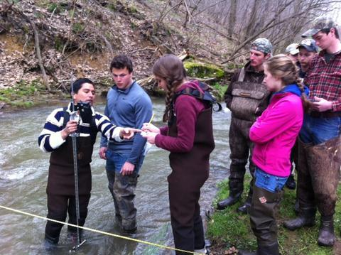

*News archive. This page was posted on February 18, 2015, and summarizes a Penn State News story originally published May 5, 2014.*

{fig-alt="Students and adults standing in a stream with monitoring equipment"}

Photo: Maddy Nyblade, via Penn State News. All rights reserved.

The May 2014 Penn State report described State College Area High School students collecting water samples and using monitoring equipment at Black Moshannon State Park through TeenShale Network.

Students worked with Penn State's Earth and Environmental Systems Institute, Shale Network, and the Susquehanna Shale Hills Critical Zone Observatory to gather baseline water-quality observations. The original report described four visits to the park and a planned presentation at the Shale Network conference on May 12, 2014.

Read the students' full story on [Penn State News](https://www.psu.edu/news/research/story/high-school-team-works-penn-state-monitor-water-gas-drilling-impact){target="_blank"}.
