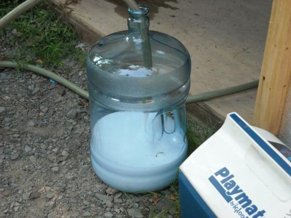

*News archive. Reporting, affiliations, and program descriptions reflect the date shown above.*

{fig-alt="A large transparent container holding water with a layer of white foam"}

Substances commonly used for drilling or extracting Marcellus shale gas foamed from the drinking water taps of three Pennsylvania homes near a reported well-pad leak, according to an analysis from a team of scientists.

The researchers used a new analytical technique on samples from the homes and found a chemical compound, 2-BE, and an unidentified complex mixture of organic contaminants, both commonly seen in flowback water from Marcellus shale activity. The scientists recently published their findings in Proceedings of the National Academy of Sciences.

"These findings are important because we show that chemicals traveled from shale gas wells more than two kilometers in the subsurface to drinking water wells," said co-author Susan Brantley, distinguished professor of geosciences and director of the Earth and Environmental Systems Institute at Penn State. "The chemical that we identified either came from fracking fluids or from drilling additives and it moved with natural gas through natural fractures in the rock. In addition, for the first time, all of the data are released so that anyone can study the problem."

Such contamination from shale gas wells in shallow potable water sources has never been fully documented before, Brantley said. The new technique  could be a valuable tool in evaluating alleged causes of unconventional gas drilling impacts to groundwater.

"More studies, such as ours, need to be disseminated to the general public to promote transparency and to help guide environmental policies for improving unconventional gas development," said Garth Llewellyn, principal hydrogeologist at Appalachia Hydrogeologic and Environmental Consulting and the paper's lead author.

The affected homes are located near a reported pit leak at a Marcellus shale gas well pad. Scientists believe stray natural gas and wastewater were driven one to three kilometers (0.6 to 1.8 miles) laterally along shallow to intermediate depth fractures to the source of the homes' well water.

State environmental regulators previously found high levels of natural gas in the water, but did not discover flowback water contamination above regulatory limits and could not determine what was making the water foam, according to the researchers.

The team used highly sophisticated equipment and tested for a range of possible contaminants at low concentration levels, rather than testing for specific substances.

"This work demonstrates that these events are possible, but that more sophisticated analytical work may be necessary to uncover the details of the impact," said co-author Frank Dorman, associate professor of biochemistry and molecular biology, Penn State. "In short, we were able to confirm water contamination because we are using non-conventional techniques. Specifically, GCxGC-TOFMS allowed for the characterization of this drinking water where routine testing was not able to determine what was causing the foaming." GC-GC-TOFMS is a form of gas chromatography coupled with mass spectrometry.

The homes were sold to the gas company as part of a legal settlement in 2012, but scientists received samples before the transfer.

The research was supported by funding from the National Science Foundation.

Read the study: [Evaluating a groundwater supply contamination incident attributed to Marcellus Shale gas development](https://doi.org/10.1073/pnas.1420279112). 

[Frequently asked questions answered by the study authors](2015-shale-network-workshop/Frequently-Asked-Questions-about-Llewellyn-et-al-2015.pdf) (PDF).
