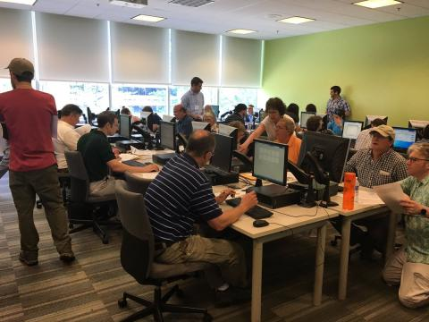

*News archive. Reporting, affiliations, and program descriptions reflect the date shown above.*

{fig-alt="A room of workshop participants working at desktop computers"}

STATE COLLEGE, Pa. — The Shale Network held its sixth annual workshop May 18 and 19 at the Penn State University Park Campus, and in State College, Pa. The workshop again drew a large, diverse group of participants interested in water quality around the Marcellus Shale drilling region in Pennsylvania.

Representatives from academia, government agencies, energy industries, environmental groups joined citizen scientists and high school students and teachers during the two-day event.

The workshop included a field trip, computer module and poster session on Thursday, May 18, and a daylong session of presentations and discussion on Friday, May 19.

We appreciated everyone’s contributions, and are thankful for another great workshop.
