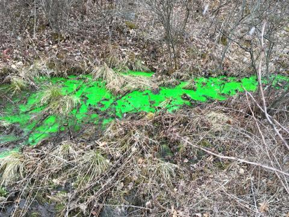

*News archive. From [Penn State News](https://www.psu.edu/news/impact/story/students-see-green-mock-spill-illustrates-potential-impact-wastewater-leak); reporting and affiliations reflect the historical story.*

{fig-alt="Bright green tracer dye moving through a small stream"}

Photo: Matt Carroll / Penn State. See the linked original story for its image credit and license.

SNOW SHOE TOWNSHIP, Pa. — Bright green water swirled around Mariah Airey’s boots as it made its way into Black Moshannon Creek.

A freshman at State College Area High School, Airey watched as green dye trickled down a tributary, mixed with the clear water in the creek and then rushed downstream.

A group of State High students participated in a mock spill event last week simulating what might happen if a contaminant spill reached the stream. 

“When it reached Black Mo, it surprised me how far it went,” Airey said. “I thought my eyes were deceiving me.”

Airey and her classmates are part of TeenShale Network, a group of high school students working with Penn State scientists to monitor water quality in local streams around Marcellus Shale development.

Penn State researchers and Pennsylvania Department of Environmental Protection staff placed environmentally safe dye in the creek to help the students visualize what might happen if a truck hauling wastewater from a Marcellus Shale well site crashed and spilled its contents.

“There are a series of wells up on the hill, and trucks carry brine from the production of shale gas out of this watershed to treatment facilities,” said David Yoxtheimer, a research assistant in Penn State’s Earth and Environmental Systems Institute. “We set the stage that a brine truck rolled over and spilled some of its brine into the creek.”

Read more about the project on the [PSU News](https://www.psu.edu/news/impact/story/students-see-green-mock-spill-illustrates-potential-impact-wastewater-leak){target="_blank"}
