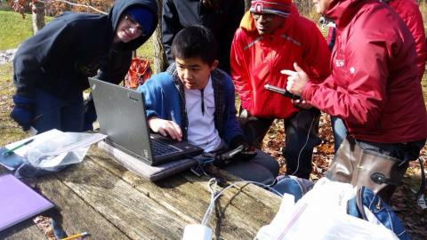

*News archive. Reporting, affiliations, and program descriptions reflect the date shown above.*

{fig-alt="Students and adults gathered around a laptop on an outdoor table"}

A group of local high school students are slipping into their hip waders and wading back into the TeenShale Network. 

With the school year back in full swing, students at State College High School have resumed work on the project, which pairs the youngsters with Penn State researchers to monitor water quality in Black Moshannon Creek.

This year, 28 students are taking part in TeenShale network, ranging from 8th to 11th grade. They will build on work the returning students have done the past three years, and search for their own hypotheses in their data. 

They learn about geology and geochemistry and about how potential environmental impacts like hydraulic fracturing could affect waterways. 

The students will collect water samples during bi-weekly field trips at Black Moshannon State Park starting in mid-October, and will work to analyze those samples in the classroom.

The project will culminate this year in April with a visit of the University of Pittsburgh Mobile Science Laboratory.
