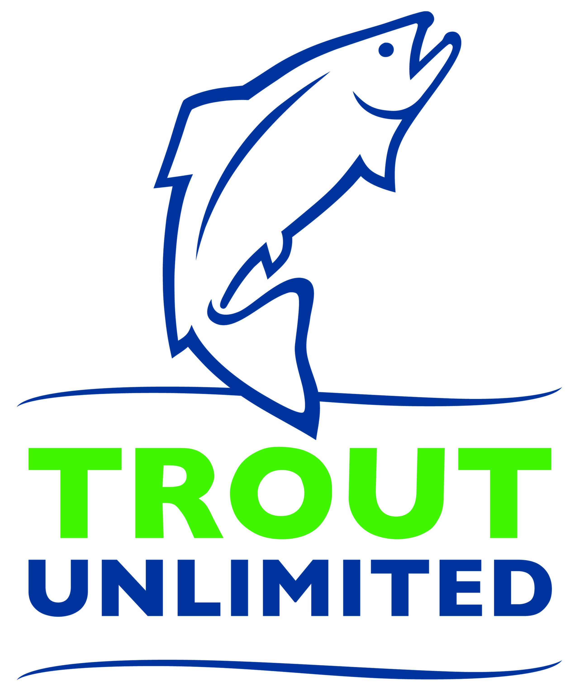

*News archive. Reporting, affiliations, and program descriptions reflect the date shown above.*

{fig-alt="Trout Unlimited fish logo"}

UNIVERSITY PARK, Pa. - Trout Unlimited has released the results of water samples taken during the latest Watershed Snapshot Day in Allegheny National Forest. Organized by Trout Unlimited, the U.S. Forest Service and Penn State, Watershed Snapshot Days bring researchers and citizen scientists together to sample dozens of streams throughout the forest for research and conservation purposes.

Watch the full video below.

<iframe title="Trout Unlimited watershed Snapshot Day results" src="https://www.youtube.com/embed/wWw9spDaD14?start=3" style="width: 100%; aspect-ratio: 16 / 9; height: auto; border: 0;" loading="lazy" allowfullscreen></iframe>

[Watch the Snapshot Day video on YouTube](https://www.youtube.com/watch?v=wWw9spDaD14&t=3s).
