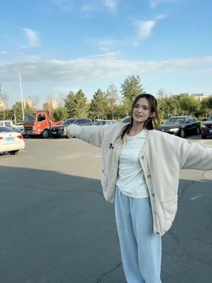
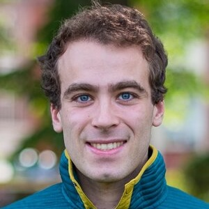
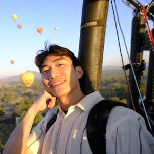

## Leadership

::: {.people-list}
::: {.person}
{.portrait width=160 height=200 fig-alt="Tao Wen"}

::: {.person-details}
### [Tao Wen](https://jaywen.com/)

Associate Professor of Earth and Environmental Sciences\
Syracuse University

[twen08@syr.edu](mailto:twen08@syr.edu)
:::
:::

::: {.person}
{.portrait width=160 height=200 fig-alt="Susan L. Brantley"}

::: {.person-details}
### [Susan L. Brantley](https://brantley.psu.edu/)

Atherton Professor of Geosciences and Evan Pugh University Professor Emerita\
Pennsylvania State University
:::
:::
:::

## Working group

::: {.people-list}
::: {.person}

::: {.person-details}
### Xiumei Ma

Postdoctoral Researcher\
Syracuse University\
Data curation
:::
:::

::: {.person}
{.portrait width=160 height=200 fig-alt="Mahnaz Sepehrmanesh"}

::: {.person-details}
### Mahnaz Sepehrmanesh

Postdoctoral Researcher\
Syracuse University\
Data curation
:::
:::

::: {.person}
{.portrait width=160 height=200 fig-alt="Sam Shaheen"}

::: {.person-details}
### Sam Shaheen

Postdoctoral Researcher\
University of Minnesota\
Data curation
:::
:::

::: {.person}
{.portrait width=160 height=200 fig-alt="Nick Su"}

::: {.person-details}
### Nick Su

Graduate Student\
Syracuse University\
Data curation
:::
:::
:::
